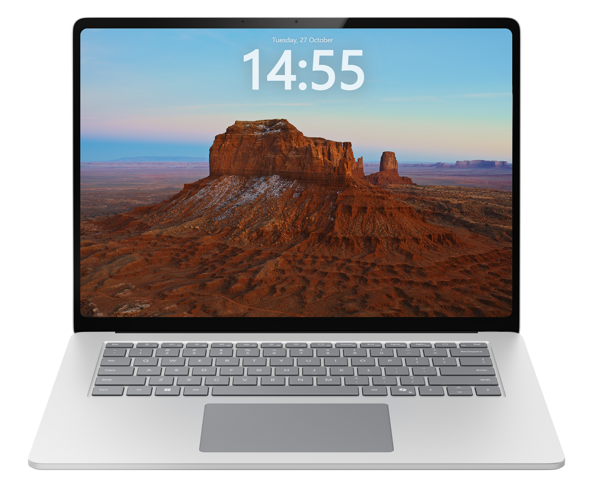

  
    

    
    
    
    

# Aerial - Apple TV Screen Saver for Windows
 
Aerial is a Windows screen saver that mimics Apple's Apple TV aerial screen saver. It plays the various videos Apple shot of cities, landscapes, underwater scenes, and the earth from the ISS.

    

> Mac user? Try [Aerial for macOS](https://github.com/AerialScreensaver/Aerial). Linux user? Try [graysky2/xscreensaver-aerial](https://github.com/graysky2/xscreensaver-aerial/). Or [View all releases](https://github.com/AerialWindows/Aerial/releases)

Be sure to configure your system's screen and sleep settings accordingly and to disable any other screensavers.

## Features
Aerial brings the AppleTV's wonderful screensavers to your Windows desktop. 
It randomly cycles through 152 beautiful slow moving videos from Apple.
You can customize the selection of used videos, tweak playback speed, set transitions, and display information like time, date, images, video location, and sunrise/sunset times on top of the video.
Aerial can download videos for offline and smoother viewing.
You can also add your own custom videos.

See the [full list of feature](https://github.com/AerialWindows/Aerial/wiki/Features-&-To-Do-List) and the [version history](https://github.com/AerialWindows/Aerial/wiki/Version-History) for detailed information.

>[Complete list of available videos.](https://docs.google.com/spreadsheets/d/1bboTohF06r-fafrImTExAPqM9m6h2m2lgJyAkQuYVJI/edit#gid=1684411812)

## Contributing

To build a single-file Windows screensaver, run `npm run build:scr` (x64), or
`npm run build:scr -- arm64`. The output is `dist/scr/Aerial-x64.scr` or
`dist/scr/Aerial-arm64.scr`. This portable build bundles the application and
extracts it when launched. The regular installer build is unchanged.

The SCR build disables the tray, login startup registration, internal idle
activation, custom locking and sleep, and automatic update installation without
changing saved preferences. Related settings are hidden. It still checks stable
GitHub releases and their update metadata, and shows a notification linking to
the releases page when a newer version is available.

Windows Screen Saver Settings can embed a live preview using `/p <HWND>` or
`/p:<HWND>` (case insensitive). The preview fills the supplied window and exits
when it closes. `/t` continues to open the separate Aerial preview window.

We are always looking for more help on this project! Some of our best features were suggested or added by the community, and we can only fix bugs if you report them. We appreciate new issues and pull requests.

[Report a bug or suggest a feature](https://github.com/AerialWindows/Aerial/issues/new/choose).

Want to help write code? Check out our [guide to contributing](https://github.com/AerialWindows/Aerial/wiki/Contributing-Guide).
It includes information on submitting ideas, how to set up Aerial's dev environment, using launch flags, and other developer information

## About
Aerial is a [Node.JS](https://nodejs.org)/[Electron](https://www.electronjs.org/) based implementation of Apple's Apple TV screensaver for Windows inspired by [Mac Aerial Screen Saver](https://github.com/JohnCoates/Aerial) and [Aerial for Windows](https://github.com/cDima/Aerial).

©2026 AerialWindows

Released under the [MIT License](https://github.com/AerialWindows/Aerial/blob/master/LICENSE)
